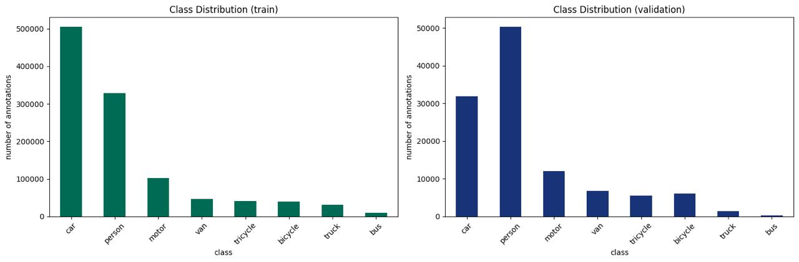
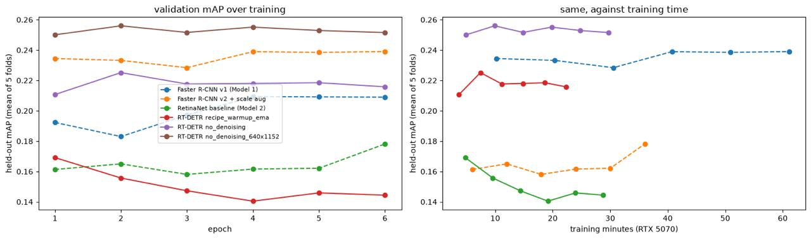

## Introduction

Нашим завданням було навчити модель знаходити об’єкти на відео, які зняті дронами. Основною метрикою для оцінювання була COCO mAP@\[.50:.95\].

Загалом ми працювали над навчанням чотирьох типів детекторів, серед їхніх видів обали моделі Faster R-CNN (двоетапна), RetinaNet (з якорями), FCOS (без якорів) і RT-DETR (на запитах). Додатково намагались покращити результати цих моделей на етапі інференсу та враховуючи інформацію із сусідніх кадрів відео.

## Data and Preprocessing
У датасеті є 56 тренувальних відео, 7 для валідації та 48 тестових. Спочатку ми проаналізували розподіл всіх 8 класів, яких розмірів є об’єкти, роздільність відео і ділянки, які не враховуються в оцінювання. 

Серед об’єктів є люди, мотоцикли, машини, вантажівки, трицикли, автобуси, фургони і велосипеди, всі класи розподілені доволі нерівномірно (переважають автомобілі (майже 46%) і люди (десь 30%), а, наприклад, автобусів лише 0,9%. Щодо розміру об’єктів, то чверть з них малі, і близько 60% середнього розміру. 



Загалом відео доволі суттєво відрізняються за к-стю, розмірами та типами об’єктів. Враховючи, що послідовні кадри досить подібні між собою, вирішили зменшити їхню вибірку до кожного 5-ого. Частка класів і розмірів об’єктів майже не змінилась, тому ми суттєво виграли в часі з цим. 

Також змінили формат запису координат об’єктів, перевірили, щоб усі рамки були в межах зображень, і окремо позначили ділянки, які не потрібно враховувати під час навчання. Значення всіх пікселів на кадрах перевели до діапазону від 0 до 1, а вже зміну розміру та нормалізацію моделі виконували самостійно. 

## Method

Для надійного порівняння ми використовували 5-фолдову крос-валідацію з поділом за відео, кожен фолд тренували на 6 епохах та зберігали стан з найкращим результатом. Після цього обчислювали середнє значення і стандартне відхилення метрик mAP, AP50, AP_small і швидкості передбачення, щоб оцінити якість та стабільність результатів. 

Всі моделі оцінювали за однаковими правилами COCO, не враховуючи ділянки ігнорування та обмежуючи кількість рамок до 100 на кадр. Через велику кількість малих об’єктів ми старались підібрати роздільність зображень окремо для кожної моделі та перевірити різні масштаби. Також для навчання використовували випадкове горизонтальне віддзеркалення з імовірністю 0.5.

Зміни в навчанні залишали, якщо mAP на крос-валідації збільшувалась не менше ніж на 0,005. Нові способи обробки передбачень залишали, якщо вони покращували загальний результат більше ніж на 0,002 і давали кращі результати хоча б на 5 із 7 відео.

## Model Training and Experiments
### Two-stage Anchor-based (Faster R-CNN)
Для неї ми обрали ResNet-50 FPN з бібліотеки torchvision, батчі по 4 зображення, стохастичний градієнтний спуск і швидкість навчання 0,01. Зображення подавали в розмірі 720/1280, а рамки, які перекривали ділянки ігнорування на 50%+, не враховували під час навчання. Ми порівняли три варіанти навчання, змінюючи функцію втрат і розклад швидкості навчання.

| Експеримент | CV mAP | OV mAP | OV AP50 | OV AP_small |
| ----- | ----- | ----- | ----- | ----- |
| Baseline (cosine LR, Smooth L1) | 0,2080 ± 0,0352 | 0,1888 | 0,3926 | 0,0842 |
| GIoU box loss | 0,2100 ± 0,0348 | 0,1845 | 0,3862 | 0,0848 |
| Step LR scheduler | 0,2110 ± 0,0337 | 0,1909 | 0,3937 | 0,0879 |

Найкращим за CV mAP та OV mAP став третій експеримент, хоча перевага над бейслайном не дуже більша.

Окремо перевірили вплив кількості пропозицій RPN на початковій моделі з фолду 0, використовуючи його відкладені кадри. У результаті, після 300 пропозицій приріст mAP майже не збільшувався, а час обробки кадру зростав, тому вирішили залишити стандартні 1000.

| К-сть пропозицій RPN | mAP (фолд 0) |
| ----- | ----- |
| 100 | 0,2165 |
| 300 | 0,2321 |
| 1000 | 0,2332 |
| 2000 | 0,2348 |
| 3000 | 0,2350 |

Тут основною проблемою залишалося виявлення малих об’єктів, бо RPN часто пропускала їх на першому етапі, а друга стадія вже не могла їх знайти. У результаті повнота становила лише 33% для малих об’єктів порівняно з 88% для великих. Також модель плутала людей із велосипедами та мотоциклами або сприймала елементи фону за людей.

### One-stage Anchor-based (RetinaNet)
Ця модель одразу визначає класи об’єктів та їхні координати без окремого етапу пропозицій RPN. Для неї також використовували ResNet-50 FPN, але з пакетами по одному зображенню розміром 800/1333 та оптимізатором AdamW зі швидкістю навчання 0,0001. Також під час навчання застосовували фокальну функцію втрат, щоб модель менше зосереджувалася на простих прикладах фону. 

У результаті, порівняли п’ять варіантів навчання, змінюючи розміри й пропорції опорних рамок, параметри фокальної функції втрат та пороги перекриття.

| Експеримент | CV mAP | OV mAP | OV AP50 | OV AP_small |
| ----- | ----- | ----- | ----- | ----- |
| Baseline | 0,1787 | 0,1483 | 0,2944 | 0,0632 |
| Anchors ×0.5 | 0,1772 | 0,1593 | 0,3429 | 0,0615 |
| Anchors ×0.5 + aspect ratios 1/3, 3 | 0,1797 | 0,1557 | 0,3358 | 0,0620 |
| Focal Loss α=0.5, γ=1.5 | 0,1789 | 0,1523 | 0,3017 | 0,0635 |
| IoU thresholds 0.4 / 0.3 | 0,1475 | 0,1238 | 0,2412 | 0,0424 |

Зменшення якорів удвічі покращило покриття всіх об’єктів (з 74% до 96%), окремо малих – із 50% до 92%, а найгірше спрацювало зниження порогів IoU. 

Загалом RetinaNet працювала гірше за Faster R-CNN, вона частіше пропускала об’єкти (42% проти 31%), неточно визначала їхні межі та деколи знаходила один об’єкт кілька разів. Ми також перевірили фокальну функцію втрат, NMS та менші якорі, але на крос-валідації жодна зі змін не дала значущого приросту mAP.

### One-stage Anchor-free (FCOS)
Тут знову використовували ResNet-50 FPN з розміром батчу 2, швидкістю навчання 0,005, розміром зображення 720/1280 та прогрівом протягом перших 500 ітерацій. 

FCOS визначає об’єкти за точками на картах ознак, через це їй складніше знаходити малі об’єкти, особливо коли вони розташовані близько один до одного.

Ми порівняли функції втрат GIoU та CIoU, і також зменшили радіус центрального семплінгу з 1,5 до 1,0, щоб перевірити, як це вплине на виявлення об’єктів у щільних сценах.

| Експеримент | CV mAP | OV mAP | OV AP50 | OV AP_small | OV AR@100 |
| ----- | ----- | ----- | ----- | ----- | :---- |
| Baseline (GIoU, radius 1.5) | 0,1969 | 0,1738 | 0,3471 | 0,0850 | 0,3922 |
| CIoU box loss (radius 1.5) | 0,1969 | 0,1793 | 0,3575 | 0,0858 | 0,3965 |
| Center sampling radius 1.0 (GIoU) | 0,1960 | 0,1848 | 0,3703 | 0,0866 | 0,3892 |

На крос-валідації всі три варіанти показали майже однаковий результат. Для злиття з іншими детекторами ми взяли варіант із радіусом 1,0, бо на кадрах для підбору налаштувань у нього були найвищі AP_small і повнота.

### Query-based (RT-DETR)
Для цього завдання обрали RT-DETR R50VD із Hugging Face, яка знаходить об’єкти за допомогою запитів до трансформера. Навчали на фолдах з розміром батчу 4 та різними швидкостями навчання для основної мережі (0,00001) і трансформера (0,0001). У початковій конфігурації використовували 300 запитів, зображення розміром 640×640, прогрів перших 500 ітерацій та EMA для усереднення ваг моделі.

Ми перевірили різну кількість запитів, ваги зіставлення, швидкість навчання основної мережі, вимкнення denoising-запитів і більший розмір вхідного зображення. 

| Експеримент | CV mAP | OV mAP | OV AP50 | OV AP_small |
| ----- | ----- | ----- | ----- | ----- |
| Baseline (300 queries, denoising) | 0,1691 | 0,1485 | 0,3146 | 0,0549 |
| 200 queries | 0,1663 | 0,1541 | 0,3243 | 0,0589 |
| 450 queries | 0,1697 | 0,1532 | 0,3244 | 0,0576 |
| Matching costs (L1=7, GIoU=3) | 0,1578 | 0,1388 | 0,2980 | 0,0515 |
| Backbone LR 2e-5 | 0,1724 | 0,1561 | 0,3298 | 0,0569 |
| No denoising | 0,2258 | 0,2147 | 0,4135 | 0,0728 |
| No denoising + 640×1152 | 0,2602 | 0,2360 | 0,4569 | 0,1138 |

У результаті робочими виявилися лише прибирання denoising-запитів (CV mAP зріс від 0,1691 до 0,2258) та ширший вхід до 640×1152 (до 0,2602). На офіційній перевірці останній варіант також показав найкращий mAP (0,2360) та AP_small (0,1138), а зміни к-сті запитів, ваг зіставлення та швидкості навчання дали незначний ефект або погіршили результат.  
Ми також перевірили NMS для готових передбачень, але окремого суттєвого покращення він не дав.

RT-DETR навчалася швидше за інші моделі та часто показувала найкращий результат вже після першої епохи. На офіційній перевірці вона добре знаходила малі об’єкти, але на кадрах з великою кількістю об’єктів працювала трохи гірше за Faster R-CNN.



## Our Pipeline
### Faster R-CNN Architecture Improvements
Для Faster R-CNN v2 ми змінили архітектуру, додавши BatchNorm і складнішу голову детекції. Також під час навчання змінювали масштаб зображень і додатково зменшували частину кадрів, щоб модель краще знаходила об’єкти на відео з нижчою роздільністю.

| Експеримент | CV mAP | OV mAP |
| ----- | ----- | ----- |
| v1 (покроковий LR) | 0.2110 | 0.1909 |
| v2 (лише архітектура) | 0.2312 | 0.2109 |
| v2 + аугментація масштабу | 0.2437 | 0.2219 |

### Five-Checkpoint Ensemble
Після навчання ми зберегли по одній моделі з кожного з п’яти фолдів і об’єднали їхні передбачення через WBF. Для FCOS використовували об’єднання без TTA, а для RetinaNet і RT-DETR – п’ять чекпойнтів на одному вигляді кадру.

| Модель | OV mAP (5 чекпоінтів) |
| ----- | ----- |
| Faster R-CNN v1 | 0,2153 |
| Faster R-CNN v2 | 0,2654 |
| RetinaNet | 0,1909 |
| FCOS | 0,2136 |
| RT-DETR | 0,2686 |


### TTA та WBF
Також протестували TTA, для цього обробляли кадри в різних масштабах і з горизонтальним віддзеркаленням, а потім об’єднували отримані рамки за допомогою WBF. 

| Модель | OV mAP до TTA | OV mAP з TTA |
| ----- | ----- | ----- |
| Faster R-CNN v1 | 0,2153 | 0,2364 |
| Faster R-CNN v2 | 0,2654 | 0,2717 |
| RetinaNet | 0,1909 | 0,2249 |
| FCOS | 0,2136 | 0,2216 |
| RT-DETR | 0,2686 | 0,2882 |

*Примітка: для Faster R-CNN v1 окремий експеримент із TTA та WBF дав приріст +0,0385 CV mAP і +0,0275 OV mAP, але збільшив час інференсу приблизно в 10 разів.* 

Загалом результати покращилися для всіх чотирьох моделей. Ми також пробували Soft-NMS і SAHI, але вони не дали достатнього покращення, тому далі їх не використовували.

### Temporal Post-processing
Щоб врахувати інформацію із сусідніх кадрів, ми застосували темпоральну постобробку, яка підвищує впевненість у стабільних детекціях і знижує її для випадкових. Спочатку оцінювали рух камери за допомогою оптичного потоку та RANSAC, після чого об’єднували детекції одного об’єкта на сусідніх кадрах у треки. 

Параметри підбирали на тренувальних відео, використовуючи передбачення моделей, які не бачили відповідних відео під час навчання. Найбільше результат покращило коригування скорів, а компенсація руху камери та відновлення пропущених рамок майже не вплинули на точність.

| Модель | OV mAP до | OV mAP після | Приріст |
| ----- | ----- | ----- | ----- |
| Faster R-CNN v1 | 0,2364 | 0,2450 | +0,0086 |
| Faster R-CNN v2 | 0,2717 | 0,2841 | +0,0124 |
| RetinaNet | 0,2249 | 0,2419 | +0,0170 |
| FCOS | 0,2216 | 0,2367 | +0,0151 |
| RT-DETR | 0,2882 | 0,3012 | +0,0130 |

### Multi-Detector Fusion
Після перевірки моделей окремо ми спробували об’єднати їхні передбачення, і найкраще серед цих поєднань спрацювало додавання FCOS до Faster R-CNN. Поєднання RT-DETR із Faster R-CNN v2 та FCOS покращило результати лише на чотирьох із семи відео.

| Поєднання моделей | OV mAP до | OV mAP після |
| :---- | :---- | :---- |
| Faster R-CNN v1 + FCOS | 0,2450 | 0,2528 |
| Faster R-CNN v2 + FCOS | 0,2841 | 0,2928 |
| Faster R-CNN v2 + RetinaNet | 0,2841 | 0,2842 |
| Faster R-CNN v2 + FCOS + RetinaNet | 0,2928 | 0,2883 |
| RT-DETR + Faster R-CNN v2 + FCOS | 0,2928  | 0,3051 |

### Unsuccessful Experiments
Також мали кілька невдалих експериментів, зокрема використання Soft-NMS, SAHI, додаткові аугментації та ансамбль трьох конфігурацій FCOS і злиття з RetinaNet. Більшість із них не покращували точність передбачень, а деякі взагалі погіршували їх.

## Results
### Model Comparison
Серед окремих детекторів найкращий результат показала RT-DETR з входом 640×1152 без denoising (CV mAP 0,2602 та OV mAP 0,2360). Наступною була Faster R-CNN v2 з аугментацією масштабу (0,2437 та 0,2219).

| Детектор | Тип | CV mAP | OV mAP | OV AP_small | мс/кадр |
| :---- | :---- | :---- | :---- | :---- | :---- |
| Faster R-CNN v1 | двоетапний | 0.2110 | 0.1909 | 0.0879 | 27.2 |
| RetinaNet | одноетапний, з якорями | 0.1787 | 0.1483 | 0.0632 | 30.2 |
| FCOS (CIoU) | одноетапний, без якорів | 0.1969 | 0.1793 | 0.0858 | 31.6 |
| Faster R-CNN v2 + аугментація масштабу | двоетапний | 0.2437 | 0.2219 | 0.0958 | 27.8 |
| RT-DETR 640×1152 без denoising | на запитах | 0.2602 | 0.2360 | 0.1138 | 28.4 |

RT-DETR – найсильніша окрема модель, і малі об’єкти вона знаходить найкраще. 

Покрокове покращення Faster R-CNN на офіційній валідації:

| Крок | Faster R-CNN v1 | Faster R-CNN v2 + масштаб |
| :---- | :---- | :---- |
| 1 чекпоінт | 0.1909 | 0.2219 |
| 5 чекпоінтів, WBF | 0.2153 | 0.2654 |
| + TTA (6 видів) | 0.2364 | 0.2717 |
| + темпоральна обробка | 0.2450 | 0.2841 (A) |
| + злиття з FCOS | 0.2528 | 0.2928 (B) |

### Kaggle Results
Для фінального оцінювання ми обрали сабміти: RT-DETR з TTA, WBF і темпоральною обробкою (публічний скор 0,3203) та Faster R-CNN v2 з тими самими кроками, без FCOS (0,3188).

Наші сабміти на Kaggle:

| № | Пайплайн | OV mAP | Публічний скор |
| :---- | :---- | :---- | :---- |
| 1 | Faster R-CNN, один чекпоінт, TTA, WBF | 0.2184 | 0.2290 |
| 2 | Faster R-CNN, 5 чекпоінтів, TTA, WBF | 0.2364 | 0.2587 |
| 3 | №2 + темпоральна обробка | 0.2450 | 0.2810 |
| 4 | Faster R-CNN + злиття з FCOS, темпоральна обробка | 0.2528 | 0.2790 |
| 5 | Faster R-CNN v2 + злиття з FCOS, темпоральна обробка | 0.2928 | 0.3095 |
| 6 | Faster R-CNN v2, TTA, WBF, темпоральна обробка | 0.2841 | 0.3188 |
| 7 | RT-DETR, TTA, WBF, темпоральна обробка | 0.3012 | 0.3203 |

## Conclusion
Найбільшого приросту якості передбачень моделі вдалося досягти завдяки зміні архітектури, роботі з малими обʼєктами та оптимізації інференсу. 

Для RT-DETR найкраще спрацювало вимкнення зашумлених навчальних запитів та перехід на роздільність 640×1152, а для Faster R-CNN найбільш вдалими стали зміни архітектури та випадкове масштабування під час навчання. 

Об’єднання п’яти моделей, перегляд кадрів у кількох масштабах і використання інформації із сусідніх кадрів дозволили підняти якість без повторного навчання моделей. Однак деякі складніші способи обробки, зокрема певні поєднання різних детекторів, нічого не додали або навіть погіршили результат. У підсумку нам вдалося покращити показник mAP на публічному лідерборді Kaggle з 0,2290 до 0,3203. 

Серед основних обмежень: незначна завищеність метрики CV mAP через вибір найкращої епохи на тому самому валідаційному фолді, на якому проводилося навчання.


## Reproducing the Results
### Environment and Setup
Для запуску моделей використовували:

* Python 3.12  
* PyTorch 2.11 (CUDA 12.8)  
* torchvision 0.26  
* transformers 4.57.6  
* pycocotools  
* ensemble-boxes

Для всіх експериментів встановили seed = 42 (у RT-DETR - 42 + номер фолду). Розподіл відео на фолди зберегли у файлі shared/sequence_folds.csv, а датасет потрібно розмістити в папці datasets/multiple-object-video-detection-hw-2-ucu-ai-2026/.

Через великий розмір ми не завантажували ваги навчених моделей на GitHub, тому для відтворення результатів спочатку потрібно навчити моделі, а вже потім запускати інференс.

### Running RT-DETR (Best Model)
Для навчання RT-DETR, отримання передбачень із TTA та запуску фінального пайплайну потрібно послідовно виконати:

```bash
python rt_detr/run_rtdetr.py
python rt_detr/inference/predict_rtdetr_views.py
python rt_detr/inference/rtdetr_pipeline.py
```

Пайплайн об’єднує передбачення п’яти чекпойнтів за допомогою WBF та застосовує темпоральну обробку. Саме цей варіант отримав 0,3203 mAP на публічному лідерборді Kaggle.

### Running Faster R-CNN v2 (Second-Best Model)
Для Faster R-CNN v2 спочатку потрібно навчити Faster R-CNN v1 через ноутбук faster_rcnn/faster_rcnn.ipynb, оскільки результати першої версії використовуються для порівняння.

Після цього потрібно послідовно виконати:

```bash
python faster_rcnn/faster_rcnn_v2/train_pilot.py
python faster_rcnn/faster_rcnn_v2/train_all_folds.py
python faster_rcnn/faster_rcnn_v2/inference/predict_v2_views.py
python faster_rcnn/faster_rcnn_v2/inference/ensemble_pipeline.py fuse tune official submit
```

Перший скрипт перевіряє зміни архітектури та масштабування на фолді 0. Другий навчає обрану конфігурацію на решті фолдів, а третій створює передбачення п’яти моделей із шістьма варіантами TTA.

Останній скрипт об’єднує передбачення через WBF, підбирає параметри темпоральної обробки, оцінює результат на офіційній валідації та створює файл для Kaggle.

Для його повного запуску також потрібні результати FCOS, оскільки скрипт порівнює Faster R-CNN v2 окремо та в поєднанні з FCOS. Для цього необхідно навчити FCOS через fcos/fcos.ipynb, отримати передбачення за допомогою fcos/inference/predict_fcos_views.py з параметрами --set, --config і --views, а потім виконати fcos/inference/evaluate_official.py.

Фінальний результат пайплайну A зберігається у файлі kaggle_submissions/faster_rcnn_updated_submission.csv. Саме цей варіант, без додавання FCOS, отримав 0,3188 mAP на Kaggle.
> Summarize your findings here.
